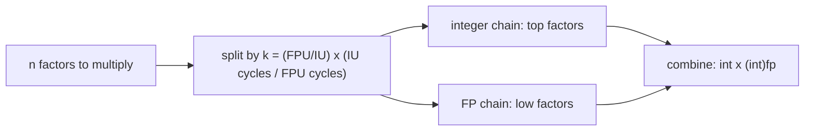

# Speeding Up Integer Programs with FPUs

Course project for Computer Architecture (CS2323), IIT Hyderabad. The project asks whether the idle floating-point unit of a superscalar CPU can be given part of an integer program's work, so integer and floating-point execution units run in parallel.

## The idea

A modern core has several integer units (IU) and floating-point units (FPU), but integer-only code leaves the FPUs idle. For workloads built from long chains of independent multiply/add operations, the chain can be split in two:

1. Compute one part with integer arithmetic.
2. Compute the rest with `float` or `double` arithmetic.
3. Combine the two partial results.

The split point is chosen from a simple throughput model. Each program defines the machine parameters as macros:

```c
#define IU          4   // number of integer units
#define IU_cycles   1   // latency of an integer op
#define FPU         2   // number of floating-point units
#define FPU_cycles  3   // latency of a floating-point op
```

and computes a ratio `k = (FPU / IU) * (IU_cycles / FPU_cycles)`. For a factorial of `n`, the integer path handles the top `n - n*k/(k+1)` factors and the floating-point path handles the remaining low factors, so the two chains can overlap in the pipeline.



## What is in the repository

| Folder | Programs | Variants |
|---|---|---|
| `Codes/Factorial programs/` | Factorial | integer, float, double, integrated (integer + FPU split) |
| `Codes/Integer Convolutions/` | 1-D convolution | integer, float, double, integrated |
| `Codes/Matrix Multiplication programs/` | Matrix multiplication | integer, float, integrated |
| `Codes/Image Processing - Blur programs/` | Image blur | integer, float, integrated |

Each folder also holds a `* time reports.txt` file with the compiler flags and measured timings. `Project_Problem_Statement.pdf` is the original problem statement.

## Building and running

Plain C with `gcc`; no dependencies.

```bash
cd "Codes/Factorial programs"
gcc -O2 Factorial_integrated.c -o Factorial_integrated -lm
echo 20 | ./Factorial_integrated
```

The integrated programs run the kernel 1,000,000 times and print the average time per call for each variant. The factorial programs also report the largest `n` for which the integer and floating-point results still agree (`n = 20`, where `20! = 2432902008176640000` is the last value that fits in 64 bits).

## Results from the time reports

All figures are average seconds per call from the `time reports` files, native `gcc` on the author's machine.

**Factorial of 20** (`IU=4, FPU=2`; integer vs float split):

| Machine model | `fact_int` | `fact_float` | `fact_double` |
|---|---|---|---|
| model: IU cycles 1, FPU cycles 3 | 57 ns | 39 ns | 40 ns |
| model: IU cycles 2, FPU cycles 4 | 54 ns | 41 ns | 40 ns |
| model: IU cycles 3, FPU cycles 5 | 51 ns | 39 ns | 39 ns |

**Convolution** (`4`-element input, `3`-element kernel), integer vs float:

| `gcc` flag | int | float |
|---|---|---|
| `-O0` | 124 ns | 101 ns |
| `-O1` | 59 ns | 53 ns |
| `-O2` | 73 ns | 71 ns |
| `-O3` | 78 ns | 60 ns |

**Matrix multiplication**, integer vs float: the integer version is as fast or faster in the sizes recorded (2x2: 10 ns vs 15 ns; 10x10: 559 ns vs 654 ns), so the float split does not help there.

## What the results say

- For the factorial and convolution kernels the FPU-assisted versions were faster than the integer-only version in every recorded configuration, by roughly 3% to 32%.
- The gain is small and varies with optimization level, so it should be read as an indication, not a general speed-up. The kernels are tiny and are timed at nanosecond scale.
- Results are machine-dependent: a re-run of `Factorial_integrated.c` at `-O2` on a different machine (WSL2) gave 104 ns (int), 97 ns (float) and 105 ns (double), i.e. about 7% for float and no gain for double.
- Matrix multiplication did not benefit: float conversions and the combination step cost more than the overlap gained.
- Correctness limit: floating-point partial products are exact only while they stay within the mantissa, so this approach is limited to small operand ranges (here `n <= 20`).

## Limitations

- Timings are from native runs of the compiled programs on a normal CPU. The project proposal called for gem5 cycle-accurate simulation; a teammate ran the programs on gem5, but those runs are not part of this repository, and the author did not run them. This repository contains no gem5 configuration or statistics files.
- The `IU`/`FPU` parameters are a model supplied by the programmer; they are not read from hardware.
- Single machine, no variance or confidence intervals.
