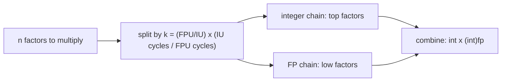

# Speeding Up Integer Programs with FPUs

An experiment on whether the idle floating-point unit of a superscalar CPU can be given part of an integer program's work, so integer and floating-point execution units run in parallel.

## The idea

A modern core has several integer units (IU) and floating-point units (FPU), but integer-only code leaves the FPUs idle. For workloads built from long chains of independent multiply/add operations, the chain can be split in two:

1. Compute one part with integer arithmetic.
2. Compute the rest with `float` or `double` arithmetic.
3. Combine the two partial results.

The split point is chosen from a simple throughput model. Each program defines the machine parameters as macros:

```c
#define IU          4   // number of integer units
#define IU_cycles   1   // latency of an integer op
#define FPU         2   // number of floating-point units
#define FPU_cycles  3   // latency of a floating-point op
```

and computes a ratio `k = (FPU / IU) * (IU_cycles / FPU_cycles)`. For a factorial of `n`, the integer path handles the top `n - n*k/(k+1)` factors and the floating-point path handles the remaining low factors, so the two chains can overlap in the pipeline.



## What is in the repository

| Folder | Programs | Variants |
|---|---|---|
| `Codes/Factorial programs/` | Factorial | integer, float, double, integrated (integer + FPU split) |
| `Codes/Integer Convolutions/` | 1-D convolution | integer, float, double, integrated |
| `Codes/Matrix Multiplication programs/` | Matrix multiplication | integer, float, integrated |

Each folder also holds a `* time reports.txt` file with the compiler flags and measured timings. `Project_Problem_Statement.pdf` is the original problem statement.

## Building and running

Plain C with `gcc`; no dependencies.

```bash
cd "Codes/Factorial programs"
gcc -O2 Factorial_integrated.c -o Factorial_integrated -lm
echo 20 | ./Factorial_integrated
```

The integrated programs run the kernel 1,000,000 times and print the average time per call for each variant. The factorial programs also report the largest `n` for which the integer and floating-point results still agree (`n = 20`, where `20! = 2432902008176640000` is the last value that fits in 64 bits).

## Results from the time reports

All figures are average seconds per call from the `time reports` files, native `gcc` on the author's machine.

**Factorial of 20** (`IU=4, FPU=2`; integer vs float split):

| Machine model | `fact_int` | `fact_float` | `fact_double` |
|---|---|---|---|
| model: IU cycles 1, FPU cycles 3 | 57 ns | 39 ns | 40 ns |
| model: IU cycles 2, FPU cycles 4 | 54 ns | 41 ns | 40 ns |
| model: IU cycles 3, FPU cycles 5 | 51 ns | 39 ns | 39 ns |

**Convolution** (`4`-element input, `3`-element kernel), integer vs float:

| `gcc` flag | int | float |
|---|---|---|
| `-O0` | 124 ns | 101 ns |
| `-O1` | 59 ns | 53 ns |
| `-O2` | 73 ns | 71 ns |
| `-O3` | 78 ns | 60 ns |

**Matrix multiplication**, integer vs float: the integer version is as fast or faster in the sizes recorded (2x2: 10 ns vs 15 ns; 10x10: 559 ns vs 654 ns), so the float split does not help there.

## gem5 results

Run with gem5 v25.1.0.1 (X86, syscall-emulation, O3 CPU, 2 GHz), kernels built with `gcc -O2 -static`. Files are in `gem5/`: `cfg.py` (the full configuration), `h_*.c` (harnesses that call the unmodified kernel functions), `one.sh`/`jobs.txt` (run list), `raw_results.txt` (instructions, cycles, FP ops per run).

Configuration (set to match the programs' macros): 4 integer ALUs and 4 integer multipliers at 1 cycle; 2 FP units at 3 cycles (all scalar/SIMD FP op classes share these two units; FP divide 12, sqrt 24, unpipelined); 32 kB 8-way L1I and L1D (2-cycle), 256 kB 8-way L2 (10-cycle), DDR3-1600. Each result is one deterministic run; per-call numbers are `(run with N calls - run with 0 calls) / N`, so process start-up is removed.

| Kernel | variant | cycles/call | vs int | FP ops/call | FPU utilisation |
|---|---|---|---|---|---|
| factorial n=20 | int / float / double | 136 / 141 / 163 | 1.00 / 1.04 / 1.20x | 0 / 20 / 12 | 0% / 7% / 4% |
| convolution 4x3 | int / float / double | 131 / 141 / 158 | 1.00 / 1.08 / 1.21x | 16 / 13 / 13 | 6% / 5% / 4% |
| convolution 64x64 | int / float / double | 20667 / 19475 / 21857 | 1.00 / 0.94 / 1.06x | 16 / 13 / 1293 | ~0% / ~0% / 3% |
| matrix mult 10x10 | int / float | 3031 / 3200 | 1.00 / 1.06x | 0 / 904 | 0% / 14% |
| matrix mult 32x32 | int / float | 98667 / 167373 | 1.00 / 1.70x | 0 / 21508 | 0% / 6% |

FPU utilisation = issued FP-class ops / (2 FP units x cycles). Small non-zero FP-op counts in int rows are SSE-class instructions the compiler emitted for integer code (not investigated further).

Findings:
- No FPU-assisted variant was faster in a way that comes from FPU work. The only faster result (convolution 64x64 float, 0.94x) executes about 13 FP ops per call: with the macros in `Convolutions_Integrated.c` (`FPU_cycles = 5`, cubed ratio) the float split index rounds to 0, so that variant is the integer code and the difference is code layout, not FPU assistance.
- Where the split does move work to the FPU (factorial, matrix multiplication), cycles went up: int-to-float conversions and the combine step cost more than the overlap saves. FPU utilisation never exceeded 14%.
- These runs do not reproduce the native speed-ups in the time reports above, which should therefore be treated as measurement noise or machine effects, not as evidence for the technique.
- The FU latencies were identical in an earlier run with a mis-built FP pool (about 6 FP-capable units instead of 2) and gave the same cycle counts, so the FP unit count and latency are not the bottleneck here.

## What the native results say

- In the native timings the float versions of factorial and convolution were faster than integer-only by roughly 3% to 32%. The gem5 runs above do not reproduce this.
- The gain is small and varies with optimization level, so it should be read as an indication, not a general speed-up. The kernels are tiny and are timed at nanosecond scale.
- Results are machine-dependent: a re-run of `Factorial_integrated.c` at `-O2` on a different machine (WSL2) gave 104 ns (int), 97 ns (float) and 105 ns (double), i.e. about 7% for float and no gain for double.
- Matrix multiplication did not benefit: float conversions and the combination step cost more than the overlap gained.
- Correctness limit: floating-point partial products are exact only while they stay within the mantissa, so this approach is limited to small operand ranges (here `n <= 20`).

## Limitations

- The native timings above are from compiled programs on a normal CPU. The gem5 results are a single configuration (one O3 core, one set of IU/FPU parameters), one run per point, at small sizes; they were not repeated across configurations or optimisation levels. An earlier gem5 run by a teammate is not part of this repository and is not reported here.
- The `IU`/`FPU` parameters are a model supplied by the programmer; they are not read from hardware.
- Single machine, no variance or confidence intervals.
