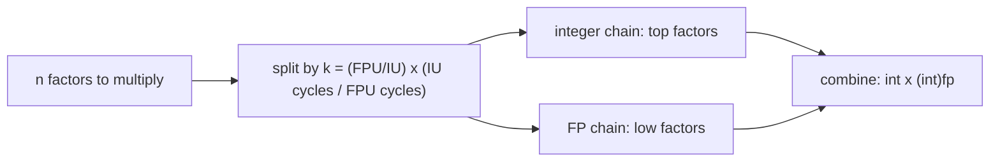

# Speeding Up Integer Programs with FPUs

An experiment on whether the idle floating-point unit of a superscalar CPU can be given part of an integer program's work, so integer and floating-point execution units run in parallel.

## The idea

A modern core has several integer units (IU) and floating-point units (FPU), but integer-only code leaves the FPUs idle. For workloads built from long chains of independent multiply/add operations, the chain can be split in two:

1. Compute one part with integer arithmetic.
2. Compute the rest with `float` or `double` arithmetic.
3. Combine the two partial results.

The split point is chosen from a simple throughput model. Each program defines the machine parameters as macros:

```c
#define IU          4   // number of integer units
#define IU_cycles   1   // latency of an integer op
#define FPU         2   // number of floating-point units
#define FPU_cycles  3   // latency of a floating-point op
```

and computes a ratio `k = (FPU / IU) * (IU_cycles / FPU_cycles)`. For a factorial of `n`, the integer path handles the top `n - n*k/(k+1)` factors and the floating-point path handles the remaining low factors, so the two chains can overlap in the pipeline.



## What is in the repository

| Folder | Programs | Variants |
|---|---|---|
| `Codes/Factorial programs/` | Factorial | integer, float, double, integrated (integer + FPU split) |
| `Codes/Integer Convolutions/` | 1-D convolution | integer, float, double, integrated |
| `Teammate-Nehith-RISCV-gem5/` | Matrix multiplication (loop swap, unrolling, float offload), minimum element, plus the group's final report | see its README |
| `Codes/Matrix Multiplication programs/` | Matrix multiplication | integer, float, integrated |

Each folder also holds a `* time reports.txt` file with the compiler flags and measured timings. `Project_Problem_Statement.pdf` is the original problem statement.

## Building and running

Plain C with `gcc`; no dependencies.

```bash
cd "Codes/Factorial programs"
gcc -O2 Factorial_integrated.c -o Factorial_integrated -lm
echo 20 | ./Factorial_integrated
```

The integrated programs run the kernel 1,000,000 times and print the average time per call for each variant. The factorial programs also report the largest `n` for which the integer and floating-point results still agree (`n = 20`, where `20! = 2432902008176640000` is the last value that fits in 64 bits).

## Results from the time reports

All figures are average seconds per call from the `time reports` files, native `gcc` on the author's machine.

**Factorial of 20** (`IU=4, FPU=2`; integer vs float split):

| Machine model | `fact_int` | `fact_float` | `fact_double` |
|---|---|---|---|
| model: IU cycles 1, FPU cycles 3 | 57 ns | 39 ns | 40 ns |
| model: IU cycles 2, FPU cycles 4 | 54 ns | 41 ns | 40 ns |
| model: IU cycles 3, FPU cycles 5 | 51 ns | 39 ns | 39 ns |

**Convolution** (`4`-element input, `3`-element kernel), integer vs float:

| `gcc` flag | int | float |
|---|---|---|
| `-O0` | 124 ns | 101 ns |
| `-O1` | 59 ns | 53 ns |
| `-O2` | 73 ns | 71 ns |
| `-O3` | 78 ns | 60 ns |

**Matrix multiplication**, integer vs float: the integer version is as fast or faster in the sizes recorded (2x2: 10 ns vs 15 ns; 10x10: 559 ns vs 654 ns), so the float split does not help there.

## gem5 results

gem5 v25.1.0.1, X86, syscall-emulation, O3 CPU at 2 GHz, kernels built with `gcc -static` at the stated `-O` level. Everything is in `gem5/`: `cfg.py` (full configuration), `h_*.c` (harnesses calling the unmodified kernel functions), `build.sh`, `jobs.txt`/`one.sh` (run list), `raw_results.txt` (cycles and FP-op counts per run).

Configuration: IntALU and IntMult units = IU count (1, 2 or 4) at `IU_cycles`; all scalar/SIMD FP op classes share FPU = 2 units at `FPU_cycles` (FP divide 12, sqrt 24, unpipelined); 32 kB 8-way L1I/L1D (2-cycle), 256 kB 8-way L2 (10-cycle), DDR3-1600. The latency pair in each row is the pair compiled into the kernel's macros and set in the simulated machine. Each point is a single deterministic run; per-call numbers are `(run with N calls - run with 0 calls) / N`.

Cycles per call, and ratio to the integer-only version (below 1 is faster):

| Kernel | Opt | IU | latency (IU/FPU) | int | float | double | float / int | double / int |
|---|---|---|---|---|---|---|---|---|
| factorial n=20 | O2 | 4 | 1/3 | 112 | 143 | 139 | 1.27 | 1.24 |
| factorial n=20 | O2 | 1 | 1/3 | 380 | 417 | 450 | 1.10 | 1.18 |
| factorial n=20 | O3 | 4 | 1/3 | 129 | 148 | 135 | 1.15 | 1.05 |
| factorial n=20 | O0 | 4 | 3/5 | 572 | 480 | 498 | 0.84 | 0.87 |
| conv 500x500 | O2 | 4 | 1/3 | 1.25M | 1.30M | 1.60M | 1.04 | 1.28 |
| conv 500x500 | O2 | 1 | 1/3 | 2.76M | 3.76M | 3.31M | 1.36 | 1.20 |
| conv 500x500 | O3 | 4 | 1/3 | 1.07M | 0.51M | 0.59M | 0.48 | 0.56 |
| conv 500x500 | O3 | 1 | 1/3 | 1.13M | 0.53M | 0.63M | 0.47 | 0.56 |
| conv 500x500 | O3 | 4 | 3/5 | 1.94M | 0.70M | 0.93M | 0.36 | 0.48 |
| matmul 32x32 | O3 | 4 | 1/3 | 96.7k | 104.9k | - | 1.08 | - |
| matmul 32x32 | O3 | 1 | 1/3 | 351k | 338k | - | 0.96 | - |
| matmul 32x32 | O2 | 4 | 1/3 | 95.8k | 167k | - | 1.75 | - |

The full grid (all three latency pairs, `-O0/-O2/-O3`, IU = 1, 2, 4) is in `raw_results.txt`.

What the runs show:
- **Convolution at `-O3` is about 2x faster** with the float split (0.36-0.48x cycles), and the gain grows as more rows are split to float. It is the same at IU = 1, 2 and 4, so it is not integer units being relieved. With `-O3 -fno-tree-vectorize` the difference disappears (float 1.03x of int), so the gain comes from the compiler vectorising the float-split loop better than the integer loop on baseline x86-64 (SSE2 has no 32-bit integer vector multiply). At `-O0` and `-O2` the float split is neutral or slower.
- **Factorial and matrix multiplication** do not gain: the split costs conversions and a combine step. Factorial is 0.84-0.87x only at `-O0` and 1.0-1.3x elsewhere; matmul is within 4% either way at IU = 1-2 and slower at IU = 4.
- **FPU utilisation is low**: at most about 14% (matmul float) and under 1% for the `-O3` convolution, counting issued FP-class ops against 2 FP units. The "integer units saturated, FPU idle" premise only partly holds even at IU = 1.
- The speed-ups in the native time reports above are therefore only partly reproduced: convolution at `-O3` yes (through vectorisation), factorial no.
- Convolution's float split index depends on the macros (`FPU_cycles`, cubed ratio): at `FPU_cycles = 5` and small `m` it rounds to 0 rows, so small-`m` runs measure the integer code.

## What the native results say

- In the native timings the float versions of factorial and convolution were faster than integer-only by roughly 3% to 32%. The gem5 runs above reproduce it for convolution at `-O3` (through vectorisation), not for factorial.
- The gain is small and varies with optimization level, so it should be read as an indication, not a general speed-up. The kernels are tiny and are timed at nanosecond scale.
- Results are machine-dependent: a re-run of `Factorial_integrated.c` at `-O2` on a different machine (WSL2) gave 104 ns (int), 97 ns (float) and 105 ns (double), i.e. about 7% for float and no gain for double.
- Matrix multiplication did not benefit: float conversions and the combination step cost more than the overlap gained.
- Correctness limit: floating-point partial products are exact only while they stay within the mantissa, so this approach is limited to small operand ranges (here `n <= 20`).

## Limitations

- The native timings above are from compiled programs on a normal CPU. The gem5 results are X86 O3 only (a RISC-V setup by a teammate is in `Teammate-Nehith-RISCV-gem5/` and was not re-run on RISC-V here), one deterministic run per point, small kernels, a fixed cache hierarchy, and a modelled FU pool. The gem5 effect for convolution at `-O3` is a compiler-vectorisation effect, not proof that scalar FPU offload relieves saturated integer units.
- The `IU`/`FPU` parameters are a model supplied by the programmer; they are not read from hardware.
- Single machine, no variance or confidence intervals.
